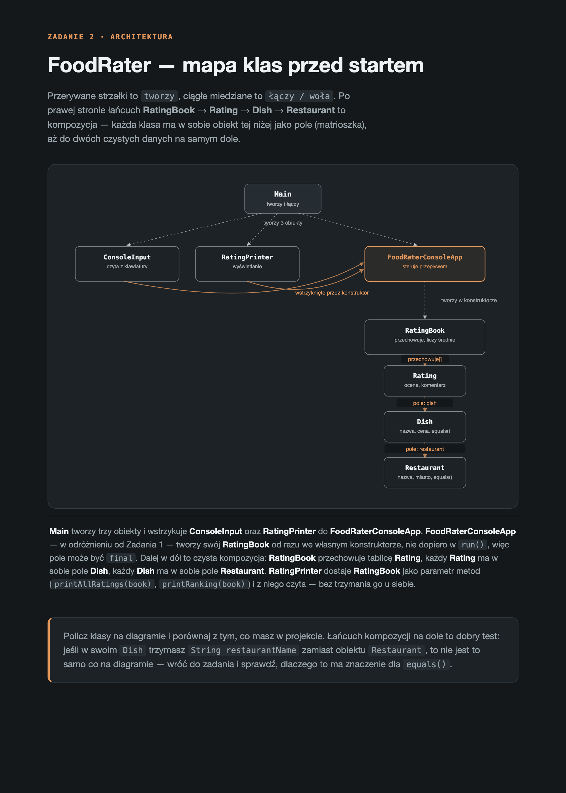

# Zadanie 2: FoodRater — oceny jedzenia od zera

**Lekcja 12.41 · Moduł 2 — podsumowanie: klasy, obiekty, enkapsulacja, kompozycja, konstruktory**

## Kontekst

W Zadaniu 1 dzieliłeś/aś na klasy coś, co już istniało (refaktoryzacja). Tutaj piszesz **od zera** — sam projektujesz podział na klasy, od pustego projektu.

Program jest celowo mały (dużo mniejszy niż Budget Analyzer) — to nie jest test wytrzymałości, tylko sprawdzenie, czy potrafisz **zaprojektować** kilka współpracujących klas, a nie tylko podzielić cudzy kod. Mała skala, ale pełen zestaw: enkapsulacja, konstruktory, kompozycja (klasa jako pole innej klasy), `equals()` **faktycznie używane** w logice (nie tylko napisane na pokaz), `toString()`, metody prywatne/publiczne, rozróżnienie klas-danych od klas-zachowań.

Punkt wyjścia à la "Książulo" / "muala" — apka do oceniania jedzenia. Użytkownik dodaje ocenę dania w restauracji (1-10 + komentarz) i ogląda ranking.

Zanim zaczniesz kodować, zobacz diagram poniżej — pokazuje, jak docelowe klasy mają się ze sobą łączyć (kto kogo tworzy, kto do kogo woła). Interaktywna wersja (działa też w dark mode) jest w `architektura-foodrater.html`.



## Co ma robić program

Konsolowe menu w pętli:

```
1. Dodaj ocenę
2. Pokaż wszystkie oceny
3. Ranking dań
4. Wyjście
```

- **Dodaj ocenę** — pyta o nazwę restauracji, miasto, nazwę dania, cenę, ocenę (1-10, z walidacją) i komentarz. To samo danie (ta sama nazwa, w tej samej restauracji) może dostać wiele ocen w czasie — program ma to rozpoznawać.
- **Pokaż wszystkie oceny** — surowa, ponumerowana lista wszystkich ocen w kolejności dodania.
- **Ranking dań** — każde danie **raz**, z liczbą ocen i średnią (nie 10 osobnych linii dla 10 ocen tej samej pizzy — jedna linia z uśrednionym wynikiem).
- **Wyjście** — kończy program.

## Dane startowe (wymagane)

Program ma **sam, automatycznie, bez pytania użytkownika**, wczytać poniższe 10 ocen zanim po raz pierwszy pokaże menu — żeby po uruchomieniu od razu było co zobaczyć w rankingu, zamiast pustej tablicy. Wstaw je np. w konstruktorze klasy sterującej (tej, która tworzy swoją "książkę ocen").

Zwróć uwagę: dwa dania (**Pizza Margherita** i **Pierogi ruskie**) pojawiają się tu **dwa razy** — to celowe. Jeśli Twój `equals()` działa poprawnie, w rankingu i tak zobaczysz je **raz**, z uśrednioną oceną z dwóch wpisów.

| # | Restauracja | Miasto | Danie | Cena | Ocena | Komentarz |
|---|---|---|---|---|---|---|
| 1 | Pizzeria Da Marco | Kraków | Pizza Margherita | 32.00 | 9 | Ciasto idealne, dowóz szybki |
| 2 | Pizzeria Da Marco | Kraków | Pizza Margherita | 32.00 | 7 | Trochę mniej sera niż zwykle |
| 3 | Kebab King | Warszawa | Kebab w bułce XL | 25.00 | 8 | Sos czosnkowy petarda |
| 4 | Sushi Zen | Wrocław | Zestaw California 12szt | 48.00 | 10 | Najlepsze sushi w mieście |
| 5 | Bar Mleczny Pod Kogutem | Kraków | Pierogi ruskie | 18.00 | 9 | Jak u babci |
| 6 | Bar Mleczny Pod Kogutem | Kraków | Pierogi ruskie | 18.00 | 6 | Tym razem trochę przypalone |
| 7 | Sushi Zen | Wrocław | Ramen Tonkotsu | 36.00 | 8 | Bulion gęsty i rozgrzewający |
| 8 | Kebab King | Warszawa | Falafel wrap | 22.00 | 5 | Suchy, mało sosu |
| 9 | Pizzeria Da Marco | Kraków | Pizza Pepperoni | 34.00 | 9 | Ostro i konkretnie |
| 10 | Trattoria Bella | Poznań | Spaghetti Carbonara | 29.00 | 7 | Smaczne, ale za słone |

Po wpisaniu tych danych i wybraniu opcji 3 (ranking) powinieneś/aś zobaczyć **8 dań** (nie 10 linii) — Pizza Margherita ze średnią 8.0 z 2 ocen, Pierogi ruskie ze średnią 7.5 z 2 ocen, reszta z 1 oceną każde. Jeśli widzisz 10 osobnych linii, Twój `equals()` (albo sposób, w jaki go używasz do grupowania) nie działa tak, jak powinien.

## Wymagane klasy (minimum)

| Klasa | Rodzaj | Odpowiedzialność |
|---|---|---|
| `Restaurant` | dane | nazwa + miasto |
| `Dish` | dane (z kompozycją) | nazwa + cena + `Restaurant` jako pole — matrioszka, jak `Engine` w `Car` |
| `Rating` | dane | `Dish` + ocena (1-10) + komentarz |
| `ConsoleInput` | zachowanie | opakowanie na `Scanner` — masz je z poprzednich zadań |
| `RatingBook` | zachowanie | przechowuje wszystkie `Rating`, liczy średnie, grupuje po daniu |
| `RatingPrinter` | zachowanie | wypisuje menu i raporty na ekran |
| `FoodRaterConsoleApp` | zachowanie | steruje menu, woła resztę klas |
| `Main` | zachowanie | tylko tworzy obiekty i je łączy |

Zwróć uwagę na dwa różne **rodzaje** klas w tej tabeli: `Restaurant`/`Dish`/`Rating` to głównie dane (pola + konstruktor + gettery + `equals`/`toString`, prawie żadnej logiki), a `RatingBook`/`RatingPrinter`/`FoodRaterConsoleApp` to głównie zachowanie (mało własnych pól, dużo metod, które coś robią z cudzymi danymi). Obie role są tu samo w sobie celowe — nie każda klasa w programie musi "robić" coś aktywnie.

## Dlaczego equals() tu faktycznie coś robi (nie jak w poprzednim zadaniu)

Za każdym razem, gdy ktoś dodaje ocenę tej samej pizzy, tworzysz **nowy** obiekt `Dish` (bo dane wpisuje się od nowa) — to nie jest ten sam obiekt w pamięci co poprzednio, mimo że logicznie to "ta sama pizza". Żeby zrobić ranking (jedna linia na danie, nie jedna linia na ocenę), `RatingBook` musi umieć rozpoznać "to już widziałem" — i do tego właśnie służy `Dish.equals()`, wywoływane w pętli (`ratings[i].getDish().equals(dish)`), a nie porównanie przez `==`. Jeśli przez pomyłkę porównasz obiekty przez `==`, każda ocena wyląduje jako osobne "danie" w rankingu, nawet gdy nazwa i restauracja są identyczne — to dobry test, czy Twój kod faktycznie działa.

**Cena celowo nie wchodzi do `equals()`** w `Dish` — nie definiuje tożsamości dania, to tylko dodatkowa informacja (ta sama pizza może dziś kosztować inaczej niż rok temu, a to wciąż ta sama pizza).

## Zasady, których pilnujemy (to wszystko było już w kursie)

- **Pola `private final`**, gettery tam, gdzie inna klasa faktycznie czyta wartość. Żadnych setterów — nic tu się nie zmienia po utworzeniu.
- **Konstruktory ustawiają wszystkie pola**, z `this.` tam, gdzie trzeba.
- **`equals()` w `Dish` i `Restaurant`**, porównujące po polach, bez rozróżniania wielkości liter w nazwach. **Nie nadpisuj `hashCode()`** — to jeszcze przed nami. `Dish.equals()` deleguje porównanie restauracji do `restaurant.equals(...)`, zamiast samemu porównywać jej pola — to dobra praktyka kompozycji.
- **`toString()` w `Restaurant`, `Dish` i `Rating`**, żeby `println(obiekt)` dawało czytelny tekst.
- **Przynajmniej jedna metoda jawnie używająca `this.`**, żeby odwołać się do własnego pola albo zawołać inną metodę na sobie (patrz `Dish.isFromSameRestaurant()` w przykładowym rozwiązaniu).
- **Metody prywatne vs publiczne** w `RatingBook`/`RatingPrinter`/`FoodRaterConsoleApp` — publiczna metoda wywołuje prywatne pomocnicze, nie robi wszystkiego sama w jednym ciągu.
- **`RatingBook` może być `final`** w `FoodRaterConsoleApp` — w odróżnieniu od Zadania 1, tu nie ma fazy "zbierania danych na starcie", więc obiekt powstaje od razu w konstruktorze, nie w `run()`.
- **`Main` jest chudy.** Tworzy `Scanner`, `ConsoleInput`, `RatingPrinter`, `FoodRaterConsoleApp` — i tyle.
- **Klasy rozmawiają wyłącznie przez publiczne metody.**

## Czego świadomie NIE używamy (jeszcze)

`ArrayList` i inne kolekcje, dziedziczenie, interfejsy, `hashCode()`, wyjątki / `try-catch`. Tablica (`Rating[]`) w pełni wystarczy — tak jak `Song[]` w zadaniu Spotify.

## Podpowiedzi do przemyślenia przed kodowaniem

1. Co się stanie w rankingu, jeśli w `RatingBook` porównasz dania przez `==` zamiast `.equals()`? Przetestuj to celowo i zobacz różnicę.
2. Dlaczego `Dish` ma w sobie pole typu `Restaurant`, a nie dwa osobne pola `String restaurantName` i `String restaurantCity`? Co by trzeba było zrobić w `equals()`, gdyby nie było obiektu `Restaurant`?
3. `RatingBook.distinctDishes()` i `RatingBook.averageScoreFor()` obie przechodzą przez tablicę `ratings` pętlą `for`, zamiast korzystać z gotowej kolekcji. To nie jest "gorsze" rozwiązanie — to jedyne narzędzie, jakie na tym etapie masz. Narysuj sobie na kartce, co się dzieje krok po kroku dla 3 ocen, 2 różnych dań.

---

*W `example-solution/` znajduje się przykładowe rozwiązanie (identyczne z tym w `src/`). Spróbuj najpierw zrobić zadanie samodzielnie — porównanie z gotowym rozwiązaniem ma sens dopiero, gdy Twój kod działa. Nazwy klas/metod nie muszą się zgadzać 1:1 — liczy się podział odpowiedzialności i to, że `equals()` faktycznie bierze udział w działaniu programu.*
